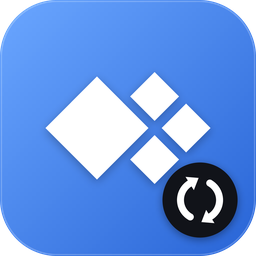
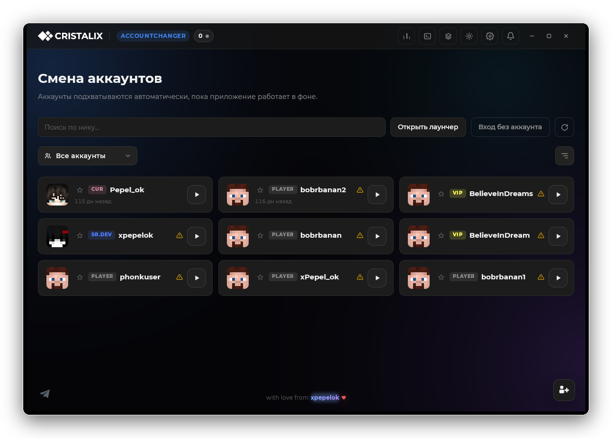
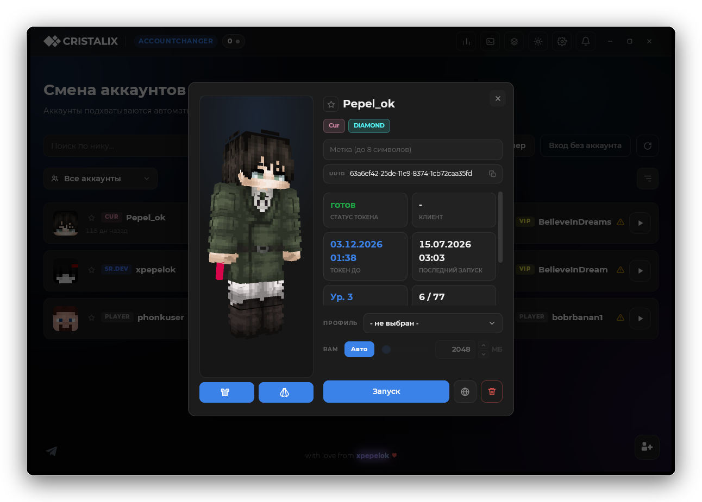
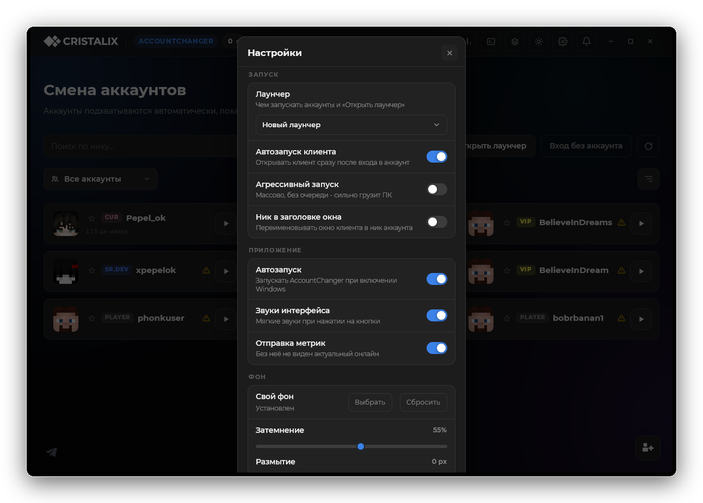
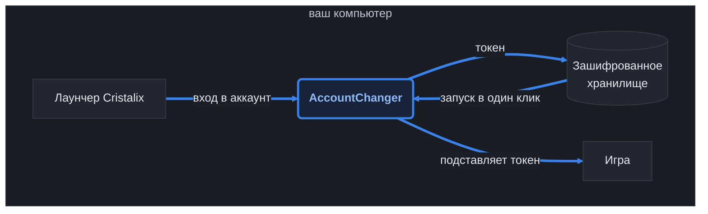

<div align="center">



# AccountChanger

Менеджер аккаунтов для Cristalix. Сам ловит токены и переключает аккаунты в один клик, без паролей.

[](https://github.com/xpepelok/cristalix-account-changer/releases)
[](https://github.com/xpepelok/cristalix-account-changer/releases/latest)
[](https://github.com/xpepelok/cristalix-account-changer/actions/workflows/ci.yml)




</div>

## Зачем это

Каждый раз выходить из аккаунта в лаунчере и вводить пароль от другого долго и неудобно, особенно
когда аккаунтов десяток. AccountChanger висит в трее и запоминает токен каждого аккаунта, под которым
ты зашёл через лаунчер. Потом любой из них запускается одной кнопкой: приложение подставит токен
и откроет игру.

## Установка

Скачай `AccountChanger.exe` со страницы [Releases](https://github.com/xpepelok/cristalix-account-changer/releases/latest)
и запусти. Установка не нужна, это один файл. Новые версии приложение скачивает и ставит само.

На Linux файл называется `AccountChanger-linux-x86_64`. Сначала разреши ему запуск, для лаунчера
ещё понадобится Java:

```bash
chmod +x AccountChanger-linux-x86_64
./AccountChanger-linux-x86_64
```

## Что умеет

- **Запуск в один клик.** Запустить аккаунт, закрыть его клиент, зайти без аккаунта.
- **Импорт по логину и паролю.** Даёшь список аккаунтов, приложение само вводит их в лаунчер и
  сохраняет токены. Замечает неверный пароль, пропускает дубли, показывает прогресс и в любой момент
  отменяется.
- **Обновление токенов.** Одной кнопкой перелогинивает аккаунты, у которых токен скоро истекает.
- **Группы.** Собираешь аккаунты в группы и запускаешь всю группу разом.
- **Профили настроек.** Сохраняешь настройки игры (управление, графика, голосовой чат) и применяешь
  к аккаунту. Есть готовый профиль «Минимальные настройки» для запуска пачкой или на слабом железе.
- **Карточка игрока.** 3D-скин и плащ, группа, подписка, онлайн-статус, метки и избранное.
- **Свой фон.** Любая картинка под интерфейсом, с затемнением и размытием.

<div align="center">

</div>

## Как пользоваться

1. Запусти AccountChanger и оставь его открытым.
2. Зайди в нужные аккаунты через лаунчер Cristalix как обычно. Каждый вход появится карточкой.
3. Дальше жми на кнопку запуска у нужной карточки.

Если закрыть окно, приложение свернётся в трей и продолжит ловить токены в фоне. Выйти полностью
можно кнопкой «Закрыть» или через правый клик по иконке в трее.

<div align="center">

</div>

## Как это работает



Приложение следит за конфигом лаунчера и забирает оттуда свежий токен после каждого входа. При запуске
аккаунта оно готовит для него отдельный экземпляр лаунчера с этим токеном и открывает игру, поэтому
пароль вводить не нужно, а несколько аккаунтов могут играть одновременно.

## Windows и Linux

Windows умеет всё, на Linux почти всё:

| Возможность | Windows | Linux |
| --- | :---: | :---: |
| Ловля токенов, запуск, группы, профили, карточка игрока | да | да |
| Импорт по логину и паролю | да | нет |
| Обновление токенов | да | нет |
| Автоклик «ИГРАТЬ» | да | нет |

На Linux недостающее делается руками: заходи в аккаунт через лаунчер (токен подхватится сам), а вместо
автоклика включи «Автовход» в настройках аккаунта.

## Безопасность и приватность

Токены хранятся в зашифрованном виде и привязаны к твоему компьютеру: на Windows через DPAPI, на Linux
ключом, который доступен только твоему пользователю. Наружу уходит только анонимная статистика онлайна,
её можно выключить в настройках.

## Сборка из исходников

Нужен [Rust](https://rustup.rs) 1.88 или новее:

```bash
cargo build --release -p accountchanger
cargo test --workspace
```

Готовый файл появится в `target/release/`. На Linux для сборки понадобятся `pkg-config`, `cmake` и
dev-пакеты `libxkbcommon-x11`, `libwayland`, `libvulkan`, `libx11-xcb`, `libxcb`, `libfontconfig`,
`libfreetype`, `libasound2`.

## Лицензия

[MIT](LICENSE)
